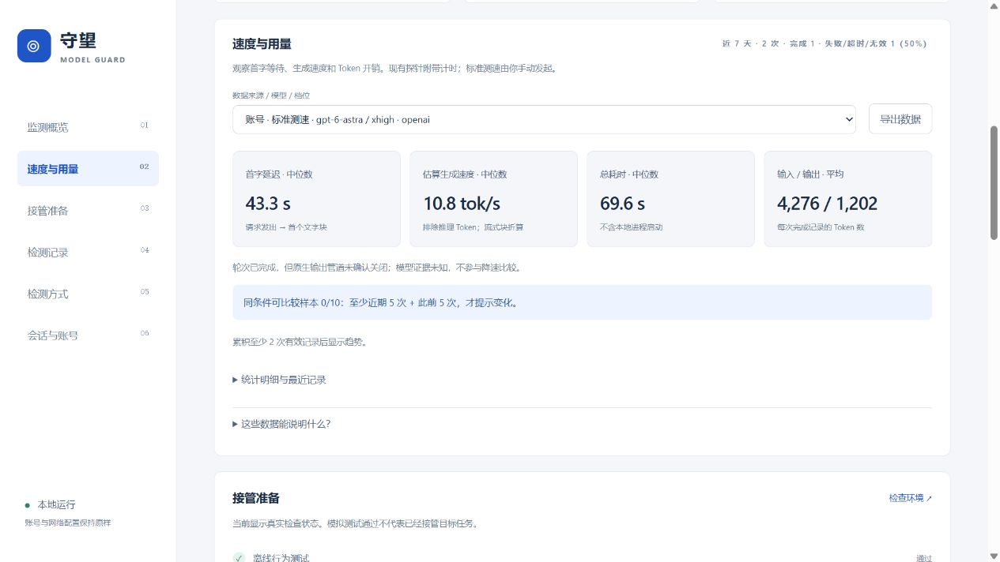

# 守望 · Model Guard

**在本地观察 AI 开发请求的模型声明、速度与用量。**

A local dashboard for model response signals, latency, token usage, and guarded task resumption. Built with Node.js, native HTML/CSS/JavaScript, and an Electron desktop shell.

当前版本 0.3.0。采用本机服务，区分客户端设置、独立请求返回的来源声明和可选行为指纹。未知数据保持未知；性能变化不会自动触发任务暂停或恢复。



图为归档运行界面。数值表示当次客户端观测，不用于跨模型排名或模型身份认证。

## 功能

- 多会话登记、搜索与切换；新增会话默认仅观察。
- 独立短探针读取响应模型声明；缺少完整证据时不放行。
- 首字延迟、总耗时、Token 用量、估算生成速度与流式停顿。
- 按来源、模型和推理档位分组；样本不足时不生成趋势结论。
- 按实际事件记录失败、超时、中断和未知状态。
- 可选任务保护与一次性恢复签发；需额外部署受信任 Hook 和宿主调度。
- 浅色 / 深色 / 跟随系统；浏览器控制台和 Electron 桌面外壳。

## 运行本地控制台

需要 Node.js 20.11+。服务和离线测试只用 Node 内置模块，启动不需要安装 Electron 依赖。真实探针需要本机已登录的兼容 Codex 环境。

```bash
git clone https://github.com/namgnal/model-guard.git
cd model-guard
node scripts/guard.mjs init
node scripts/guard.mjs serve
```

打开命令返回的本机链接。链接包含临时访问凭证，只在本机使用。启动控制台不等于自动启用任务保护。

运行数据默认保存于 `CODEX_HOME/model-guard`；未设置时使用用户目录下 `.codex/model-guard`。可通过 `MODEL_GUARD_DATA` 指定独立数据目录，首次试用推荐使用新目录。

手动运行模型探针或标准测速会消耗模型用量；页面刷新和查看统计不发起推理。探针共用调用预算。

## 测试与桌面开发

```bash
node --test tests/*.test.mjs
```

2026-10-08 公开副本复测 83 项离线测试全部通过，包含本地服务、桌面启动、速度与用量统计及任务恢复约束。环境与历史真实探针结果见 [验证记录](docs/validation.md)；模拟测试和真实请求分别统计。

桌面开发需锁定依赖；当前打包脚本面向 Windows x64：

```bash
npm ci
npm run desktop
npm run desktop:build
```

打包脚本随包复制当前 Node 运行时并下载对应许可证。仓库提供源码，不包含本机安装包或已经配置好的保护服务。完整 Hook 安装及宿主调度必须按使用环境配置；恢复约束见 [BRIDGE.md](BRIDGE.md)。

## 测量与保护边界

[测量口径](docs/measurement.md) 解释首字延迟、Token 速度估算、分组和趋势规则。客户端耗时包含排队和传输；流式块间隔不等于逐 Token 延迟。

独立探针只能说明其自身请求，不能证明其他请求使用相同模型。响应声明不是权重身份的密码学证明。Hook 无法撤销已完成操作，也不能覆盖所有宿主工具。恢复要求新鲜的同轮快照、明确授权及一次性标记；用户手动停止、完成任务或等待输入时不得恢复。

## 来源与许可

由 [namgnal](https://github.com/namgnal) 设计并借助 AI 编程工具开发。本项目采用 [MIT](LICENSE)。可选指纹模块引用 [ModelTrace](https://github.com/xqy2006/ModelTrace)，保留原许可证和固定版本信息，见 [第三方说明](THIRD_PARTY_NOTICES.md)。
